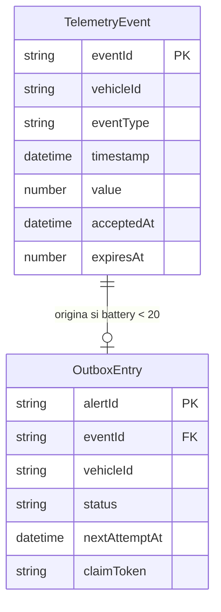

# Especificación funcional de U1 — núcleo integrado

## Alcance y decisiones

TelemetryService es el único propietario de validación, persistencia, publicación y recuperación. API Gateway REST y EventBridge activan la misma Lambda. Dos tablas conservan TelemetryEvent y OutboxEntry; SQS solo recibe alertas. El primer intento de envío sucede tras confirmar la transacción y antes del 202, según functional-design-questions.md. El envío está acotado en tiempo; su resultado no cambia una aceptación ya durable.

entities.md es la fuente de verdad de la forma de los datos; rules.md lo es de las decisiones. Este documento fija el orden de los flujos y las transiciones de estado.

## Flujo F1 — solicitud HTTP nueva

1. API Gateway comprueba ruta, método, clave y plan de uso. Solo POST /telemetry-events admitido llega a la Lambda.
2. La Lambda distingue el evento proxy HTTP de la activación EventBridge y asigna un correlationId válido, conservando el encabezado válido o generando otro. Nunca registra la clave ni el cuerpo crudo.
3. Analiza JSON y valida esquema exacto, identificadores, tipo, rango, UTC y límite de cinco minutos. Un rechazo responde 400 y termina sin efectos.
4. Canonicaliza el instante UTC y value numérico para comparar duplicados. Captura acceptedAt una sola vez con precisión de segundos y calcula expiresAt desde ese mismo instante.
5. Intenta una transacción condicional que crea TelemetryEvent por eventId y, solo si battery.value < 20, crea OutboxEntry PENDING por alertId determinista. La salida guarda vehicleId y correlationId para poder publicar incluso después de TTL del evento.
6. Si la transacción confirma sin salida, responde 202 con eventId, acceptedAt y correlationId. Si confirma con salida, inicia F3 con presupuesto de tiempo limitado y luego responde ese mismo 202, independientemente del resultado SQS.
7. Si DynamoDB falla o su resultado es incierto, no afirma una aceptación nueva: consulta por eventId para distinguir commit real de ausencia. Si comprueba identidad exacta, aplica F2; si comprueba conflicto, responde 409; si no puede comprobarlo, responde 503 y el productor reintenta con el mismo eventId.

Una respuesta 202 prueba la confirmación del evento y de su salida, cuando aplica; no prueba que el consumidor externo haya recibido la alerta. La latencia p95 y el presupuesto del intento se concretan y miden en NFR Design/Infrastructure Design.

## Flujo F2 — duplicado o conflicto

1. Una transacción condicional pierde porque eventId ya existe. Leer el primer evento de forma coherente; una carrera de lectura se reintenta de forma acotada o se trata como estado incierto.
2. Comparar eventId, vehicleId, eventType, timestamp UTC normalizado y value numérico. El encabezado de correlación y rawPayload no participan.
3. Si coincide, responder 202 con el acceptedAt y correlationId originales, sin reescribir evento/Outbox ni iniciar otro envío por esta solicitud.
4. Si difiere, responder 409 IDEMPOTENCY_CONFLICT y conservar los datos originales. Un fallo de lectura impide afirmar si es duplicado o conflicto y responde 503.

## Flujo F3 — publicar una salida

1. Consultar la salida por alertId y reclamar condicionalmente solo si sigue PENDING, está vencida y no tiene un arrendamiento vigente. La reclamación asigna claimToken, leaseUntil, lastAttemptAt, incrementa attempts y fija nextAttemptAt para que otros barridos no la tomen durante el intento. Si otro actor ganó, terminar sin publicar.
2. Formar LowBatteryAlert desde los datos durables de la salida: alertId, eventId, vehicleId, alertType, batteryValue y occurredAt; adjuntar correlationId como atributo del mensaje.
3. Enviar a SQS de alertas dentro del presupuesto. Si se confirma, actualizar condicionalmente PENDING a PUBLISHED con el claimToken vigente; limpiar el arrendamiento. La actualización nunca crea otra salida.
4. Si SQS falla, liberar condicionalmente el arrendamiento y fijar un próximo intento con retroceso. Si el resultado es incierto o no se pudo actualizar el estado, mantener PENDING y permitir recuperación al vencer el arrendamiento. No crear otro alertId.
5. Una confirmación SQS seguida de fallo al marcar PUBLISHED puede causar reentrega física. El consumidor contractual deduplica por alertId y produce un único efecto lógico.

El arrendamiento reduce propietarios simultáneos, pero su vencimiento puede permitir otro envío si el primero queda incierto. La transacción condicional y el token impiden que un propietario anterior marque PUBLISHED después de perder la posesión.

## Flujo F4 — recuperación programada

1. Reconocer exclusivamente el evento programado de EventBridge por source y detail-type; una forma desconocida falla sin tratarse como solicitud HTTP.
2. Consultar, mediante un acceso indexado y paginado, únicamente salidas PENDING con nextAttemptAt vencido. Procesar un lote acotado y respetar el tiempo restante de la Lambda; no hacer barrido completo de tabla.
3. Para cada candidata, ejecutar F3. Una reclamación perdida se omite. Un fallo de una salida no cambia las demás; la salida fallida sigue PENDING para otra ronda.
4. Registrar cantidades de elegibles, reclamadas, confirmadas, fallidas y pendientes con correlación de la invocación. Publicaciones inciertas conservan alertId.

La estrategia física de índice, distribución de particiones, tamaño de lote, frecuencia, arrendamiento y retroceso se fija en Infrastructure Design. Debe satisfacer la consulta acotada y la recuperación eventual de todas las salidas PENDING.

## Estados de OutboxEntry

| Estado inicial | Evento | Condición | Estado final | Observación |
|---|---|---|---|---|
| Inexistente | Commit de batería baja | Transacción confirmada | PENDING | Evento y salida aparecen juntos. |
| PENDING libre | Reclamación | Vencida y condición ganada | PENDING reclamada | Token temporal; no equivale a entrega. |
| PENDING reclamada | SQS confirmado | Token aún válido y actualización confirmada | PUBLISHED | Estado terminal para publicación. |
| PENDING reclamada | Fallo SQS | Liberación condicional | PENDING diferida | Próximo intento posterior. |
| PENDING reclamada | Resultado incierto o caída | Arrendamiento vence | PENDING elegible | Reintento con el mismo alertId. |
| PUBLISHED | Cualquier barrido o duplicado HTTP | Siempre | PUBLISHED | No se vuelve a enviar deliberadamente. |

Ningún flujo convierte PUBLISHED en PENDING ni borra una salida PENDING. La retención eventual de PUBLISHED se decidirá con la política operativa; nunca se ata al TTL del evento mientras la publicación esté pendiente.

## Escenarios de aceptación y errores

| Escenario | Resultado |
|---|---|
| battery 0 o 19,99 | Evento + salida PENDING atómicos; intento F3; 202 después del commit. |
| battery 20, temperature o speed | Solo evento; ninguna alerta. |
| Valores en límites inclusivos, timestamp exactamente +5 min | Aceptados si los demás campos son válidos. |
| JSON inválido, campo ausente, fuera de rango, timestamp no UTC o >+5 min | 400, sin efectos. |
| Clave ausente/inválida, ruta distinta o cuota excedida | Rechazo en API Gateway; Lambda no invocada. |
| Commit fallido o incierto no comprobable | Sin 202 nuevo; ningún estado parcial; 503 si transitorio. |
| Duplicado exacto simultáneo | Un evento y como máximo una salida; 202 original; ningún nuevo intento causado por duplicado. |
| Mismo eventId, contenido diferente | 409; primer evento inmutable. |
| SQS falla tras commit | 202; salida PENDING para EventBridge. |
| SQS confirma y actualización falla | PENDING recuperable; posible copia física con igual alertId. |
| Dos barridos concurrentes | Solo reclamante ganador envía mientras dura el arrendamiento. |
| TTL elimina el evento antes del envío | La salida PENDING conserva todos los campos para publicar y no depende de leer el evento. |

## Vista derivada de relaciones

Alternativa textual: un TelemetryEvent puede originar cero o una OutboxEntry; cada salida se crea con un único evento, aunque el registro del evento pueda desaparecer posteriormente por TTL.

## Vista derivada de reglas

BR1 valida antes de cualquier efecto; BR2 decide la transacción, duplicados y 202; BR3 crea y forma alertas de batería baja; BR4 reclama, confirma y recupera; BR5 conserva la topología y seguridad. Los detalles completos están en rules.md.

## Límites para las etapas siguientes

- NFR Design e Infrastructure Design deben asignar presupuestos y valores medibles al intento SQS, la concurrencia, el arrendamiento, el retroceso, la frecuencia EventBridge, el índice de PENDING y el lote. El presupuesto HTTP debe permitir medir p95 ≤ 500 ms a 100 solicitudes válidas/s en staging.
- Code Generation implementa dos entradas en una sola Lambda y prueba las carreras, el commit incierto, el umbral 20, la recuperación y la deduplicación contractual con AWS simulado.
- U2 extiende validación, cuota, métricas y operación; U3 agrega CI, identidad OIDC y protección de despliegue sin alterar las identidades y transiciones de U1.

## Fuentes

Inception: unit-of-work.md, unit-of-work-story-map.md, requirements.md, components.md, contract-summary.md y user-stories/stories.md. Decisión de primer intento: functional-design-questions.md.
