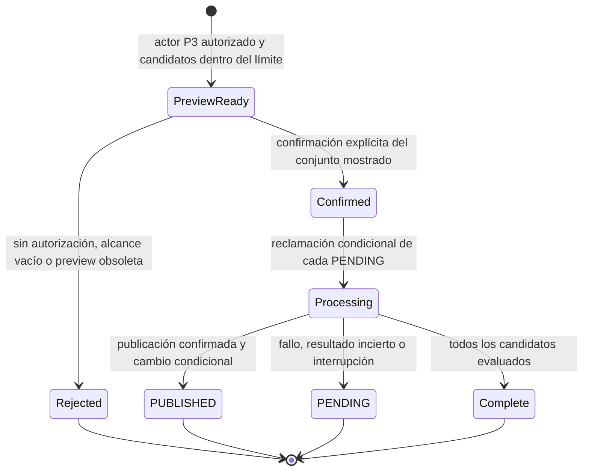
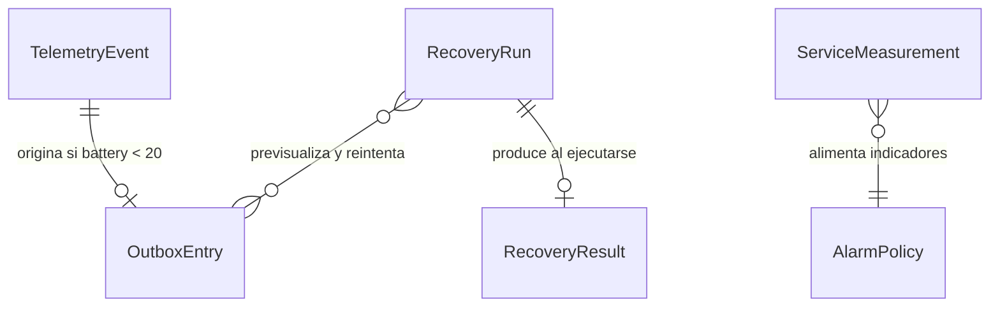

# Especificación funcional de U2 — ampliación operativa

## Alcance y decisiones

U2 amplía el único TelemetryService y las entidades TelemetryEvent/OutboxEntry que U1 ya posee. Conserva la API HTTP, la semántica de idempotencia, la transacción de evento y Outbox, `alertId`, la recuperación programada y la topología de una sola Lambda. La decisión Q1 establece una CLI operativa propia con vista previa y confirmación explícita. La CLI presenta una operación autorizada del mismo servicio; no adquiere propiedad de datos ni crea una Lambda o cola de ingreso nueva.

`entities.md` es la fuente de verdad de los datos; `rules.md` es la fuente de verdad de las decisiones. Este documento define el orden de los flujos, resultados y estados.

## Flujo F5 — validar y limitar una solicitud

1. El límite HTTP valida método/ruta, clave API y cuota por clave. Un rechazo termina antes de invocar TelemetryService.
2. Para cada solicitud admitida, TelemetryService analiza el cuerpo y valida presencia, tipo, identificadores, tipo de evento, finitud del valor, timestamp UTC y rango específico del evento.
3. El timestamp exactamente cinco minutos posterior al reloj del servicio es válido; cualquier instante posterior se rechaza. Los valores límite de batería, temperatura y velocidad son inclusivos.
4. Un fallo de validación responde `400` y no escribe TelemetryEvent ni OutboxEntry ni publica a SQS. El rechazo de clave o cuota ocurre en el límite HTTP sin invocar Lambda.
5. Ante fallo transaccional, la respuesta nunca es un nuevo `202`; evento y Outbox no quedan parcialmente escritos. El error se correlaciona y no incluye claves ni payload crudo.
6. Las solicitudes de cada clave se limitan a la política acordada: tasa objetivo 100/s, ráfaga 200 y cuota diaria 5,000,000. La medición reconoce que el proveedor aplica estos valores como objetivos de mejor esfuerzo.

## Flujo F6 — preparar y ejecutar recuperación manual

1. P3 invoca la CLI con una identidad operativa autorizada y especifica el alcance y límite del lote. La clave de API de productor no concede acceso operativo.
2. TelemetryService determina candidatos elegibles `PENDING` dentro del alcance autorizado, sin superar el límite explícito. Si el alcance está vacío, la CLI informa cero candidatos y no ofrece una ejecución con efectos.
3. La vista previa presenta alcance, IDs ordenados, cantidad, límite, emisión y vencimiento fijados por el servicio, junto con una referencia verificable que liga todos esos campos. El cliente no puede ampliar el límite, renovar la vigencia ni reemplazar candidatos sin obtener otra vista previa. No muestra secretos ni payload crudo.
4. P3 confirma explícitamente la vista previa vigente. El servicio vuelve a comprobar su referencia, todos sus campos y el vencimiento, además de la autorización efectiva de la nueva invocación. Una vista previa alterada, vencida, vacía o sin confirmación se rechaza antes de cambiar salidas. El actor del payload nunca concede autorización; el identificador de invocación de la plataforma enlaza la operación con su identidad auditada.
5. Por cada candidato confirmado, TelemetryService usa las mismas condiciones de reclamación y envío durable que la recuperación programada. Una carrera perdida se omite; el envío reutiliza `alertId` y no crea evento ni Outbox nuevos.
6. Tras confirmación de publicación, la salida pasa condicionalmente de `PENDING` a `PUBLISHED`. Ante fallo o resultado incierto, permanece `PENDING` para recuperación posterior, automática o manual.
7. Antes de cada nueva reclamación se comprueba el presupuesto global de la invocación, reservando tiempo para registrar y devolver el resultado. Al agotarlo no se inician más envíos y se devuelve una respuesta parcial. La CLI muestra correlaciones, identificador de invocación y cantidades confirmadas, fallidas, omitidas y no iniciadas que reconcilian la población de la vista previa; el conteo PENDING es una observación separada. Nunca afirma como confirmado un envío incierto. Una confirmación repetida vuelve a comprobar las condiciones y omite salidas ya publicadas; no crea eventos ni salidas adicionales.

Alternativa textual: una vista previa autorizada solo progresa con confirmación explícita; cada salida queda PUBLISHED únicamente tras confirmación del envío, y todo resultado no confirmado conserva PENDING.

## Flujo F7 — medir los objetivos operativos

1. En `staging`, generar una cohorte de carga sostenida de 100 solicitudes válidas por segundo y medir latencia de extremo a extremo; informar p95 y compararlo con 500 ms.
2. Correlacionar recepción, commit durable y respuesta. Todo `202` debe suceder después del commit del evento y de la salida `PENDING` cuando aplique. Calcular el porcentaje que alcanza persistencia en menos de 30 segundos; objetivo mínimo 99 %.
3. Para disponibilidad mensual, construir la población de minutos disponibles, fallidos y en mantenimiento del mes calendario. Calcular `disponibles / (disponibles + fallidos + mantenimiento) × 100`; el denominador incluye mantenimiento. Primero validar la fórmula con datos sintéticos y después medir el mes real de `staging` contra 99.9 %.
4. Para retención, comprobar por evento `expiresAt = acceptedAt + 90 días` exactos. Medir los registros elegibles que siguen presentes como backlog; la eliminación física de TTL es eventual y no tiene plazo máximo contractual.
5. Guardar el periodo, entorno, conteos, resultado calculado e identificadores de correlación suficientes para explicar la población medida.

## Flujo F8 — emitir señales y responder a alarmas

1. Clasificar solicitudes aceptadas/rechazadas y fallos de Lambda, persistencia, EventBridge y publicación con correlación y causa disponible, evitando secretos y payload crudo.
2. Producir señales que permitan observar edad/cantidad PENDING, profundidad de SQS de alertas y acumulación de registros elegibles para TTL pero no eliminados.
3. Para cada alarma definir indicador, umbral, ventana, severidad, destino y acción de recuperación. Infrastructure Design asigna los valores concretos de los umbrales y ventanas por entorno.
4. Cuando se active una alarma, P3 correlaciona API Gateway → TelemetryService → TelemetryEvent/OutboxEntry → SQS de alertas y, si aplica, EventBridge → la misma Lambda.
5. Una alarma de backlog PENDING dirige al procedimiento de diagnóstico y recuperación controlada; una alarma de acumulación TTL distingue elegibilidad de borrado físico eventual.

## Límites para las etapas siguientes

- Infrastructure Design concreta los umbrales y ventanas por alarma, configuración de cuotas/tasa, límites máximos físicos de preview/lote, identidad IAM de P3, frecuencia de EventBridge y restricciones de concurrencia.
- Code Generation implementa la CLI y su interacción autorizada con el caso de uso de TelemetryService, además de métricas y resultados correlacionables, preservando C1–C5 y sin nueva Lambda ni cola de ingreso.
- Performance Validation ejecuta el perfil de staging y valida p95, durabilidad, disponibilidad mensual y retención con poblaciones rastreables.

## Vista derivada de relaciones

Alternativa textual: un evento puede originar cero o una salida. Una ejecución de recuperación previsualiza y reintenta varias salidas dentro de su límite y produce un resultado. Las mediciones operativas alimentan las políticas de alarma.

## Vista derivada de reglas

BR6 completa la validación y limitación previa a efectos; BR7 restringe la recuperación manual a actores autorizados, preview acotado y confirmación auditable; BR8 define cómo demostrar objetivos de latencia, durabilidad, disponibilidad y retención; BR9 especifica las señales y los campos requeridos para alarmas accionables.

## Fuentes

`inception/units-generation/unit-of-work.md`, `inception/units-generation/unit-of-work-story-map.md`, `inception/requirements-analysis/requirements.md`, `inception/domain-design/components.md`, `inception/contract-design/contract-summary.md` y `inception/user-stories/stories.md`.

## Revisión del intento

El hallazgo F6 de `construction/build-and-test/findings.json` concreta la vigencia, el límite, la identidad auditada y el presupuesto global que el flujo anterior ya exigía. Infrastructure Design fijará los valores y el mecanismo verificable sin añadir otra Lambda ni cola de ingreso. Code Generation debe probar confirmación alterada, vencida, repetida o no autorizada y detención parcial, conservando la recuperación posterior. F5 exige señales clasificadas y tiempos recepción/commit; la fórmula mensual conserva el denominador completo y los resultados reales pendientes.
