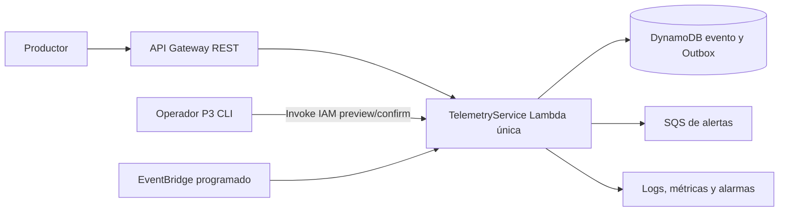

# Componentes lógicos — NFR U2

## Inventario y límites

Los componentes y límites aquí mapean **NFR9.10, NFR9.11, NFR9.12 y NFR9.13** a los recursos existentes y sus cambios compatibles.

| Componente lógico | Responsabilidad | Límite de confianza/fallo | Datos/recursos bajo su uso |
|---|---|---|---|
| TelemetryService | Validación, persistencia, Outbox, publicación, recuperación programada y solicitud de recuperación autorizada. | Único propietario de reglas e invariantes; fallos se aíslan por solicitud/entrada. | TelemetryEvent, OutboxEntry, métricas y logs. |
| API Gateway REST | Validar clave, ruta, cuota y tasa de productores antes de invocar el servicio. | Frontera externa de productor; rechazos no alcanzan Lambda. | Contrato C1 y plan por clave. |
| CLI de operaciones | Solicitar preview y ejecución confirmada como identidad P3 mediante invocación IAM de la misma Lambda. | Herramienta confiable solo con sesión autorizada; no accede directamente a tablas/SQS. | IDs, resumen, huella, límite, correlación. |
| Persistencia evento/Outbox | Confirmar evento y salida atómicamente; permitir consulta de pendientes vencidos y actualización condicional. | La transacción es la frontera de durabilidad; las salidas preservan identidad tras TTL del evento. | Dos tablas propiedad de TelemetryService. |
| Publicación de alertas | Enviar mensajes con alertId estable y marcar confirmado solo tras respuesta positiva. | SQS puede fallar o resultar incierta; Outbox evita pérdida lógica. | SQS solo para alertas. |
| Recuperación EventBridge | Invocar periódicamente la misma Lambda para procesar lotes pendientes elegibles. | Fallo de invocación no elimina salida; alarma y siguiente ciclo recuperan. | Regla existente de EventBridge. |
| Observabilidad operativa | Logs, métricas, alarmas y panel SLI para soporte P3. | Acceso de lectura restringido; dimensiones de métrica limitadas. | Canal de guardia configurado para entorno. |

## Mapa de impacto

Un fallo de cuota afecta solicitudes de la clave y no muta persistencia. Una transacción fallida afecta una aceptación, nunca crea mitad de evento/Outbox. Una indisponibilidad SQS acumula PENDING y activa señales; la recuperación automática y la CLI autorizada usan la misma lógica. Un fallo de alarma no cambia los datos y se detecta mediante salud del monitoreo. Ninguna frontera nueva puede escribir directamente en Outbox.

## Vista de flujo

Alternativa textual: API Gateway, CLI P3 y EventBridge son disparadores distintos del mismo TelemetryService. Solo este servicio accede a tablas y SQS de alertas; sus logs y métricas alimentan observabilidad.

## Fuentes

`nfr-requirements/tech-stack-decisions.md`, `nfr-requirements/security-requirements.md`, `nfr-requirements/scalability-requirements.md`, `functional-design/entities.md`, `functional-design/functional-spec.md` y `inception/contract-design/contract-summary.md`.
