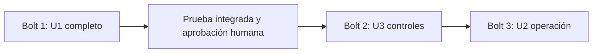

# Plan de Bolts de telemetría vehicular

Un **Bolt** es una pasada de construcción sobre una unidad que termina en un resultado ejecutable y comprobable. Este plan usa un Bolt por unidad, en serie. La primera entrega es el **walking skeleton**: la menor rebanada funcional de extremo a extremo, con código y prueba integrada reales, que demuestra el recorrido completo antes de ampliar el servicio. No se acepta una Lambda ficticia que solo devuelva `202`.

## Secuencia acordada

| Orden | Bolt | Unidad | Historias principales | Depende de | Resultado comprobable |
|---|---|---|---|---|---|
| 1 | `b1-telemetry-core` | U1 `u1-telemetry-core` | US6.1, US2.1, US1.1, US3.1, US3.2, US4.1 | Ninguna unidad | Servicio integrado y recuperación de alertas |
| 2 | `b2-delivery-controls` | U3 `u3-delivery-controls` | US6.2, US6.3 | U1 aprobado | CI, OIDC, CloudTrail y promoción protegida |
| 3 | `b3-telemetry-operations` | U2 `u2-telemetry-operations` | US1.2, US4.2, US5.1, US5.2 | U1 aprobado | Operación, validación completa y SLO medibles |

El grafo de unidades permite U2 y U3 después de U1 sin dependencia mutua. El orden U3→U2 es una preferencia económica confirmada, no una nueva arista. Se conservan `Construction Iteration: unit-major`, `Construction Execution: serial` y `Construction Checkpoints: enabled`. Cada unidad recorre sus etapas de diseño, código y prueba antes de empezar la siguiente. El trabajo se lleva en una sesión asistida; cada rama corta sale de `main`, pasa por *pull request* y se integra con *squash*.

**Lectura textual:** construir y comprobar U1; tras su aprobación, entregar U3 y luego U2. U3 y U2 podrían intercambiarse sin romper el grafo si una decisión posterior revisa el orden.

## Bolt 1 — Núcleo integrado U1

**Objetivo y alcance.** Implementar en TypeScript una API Gateway REST con clave de API y una sola Lambda `TelemetryService` activada también por EventBridge. La Lambda valida antes de escribir, confirma `TelemetryEvent` y, para `battery.value < 20`, `OutboxEntry PENDING` en una transacción DynamoDB; publica la alerta en la única SQS del flujo y recupera pendientes con el mismo `alertId`. AWS CDK define dos tablas, una cola de alertas, una Lambda, la regla periódica, KMS y permisos mínimos. La infraestructura inicial incluye los elementos CloudTrail necesarios para que U3 complete su protección y verificación.

**Definition of Done.**

- El contrato C1 devuelve `400` sin efectos para una entrada inválida, `202` solo tras confirmar la transacción y `409 IDEMPOTENCY_CONFLICT` sin reemplazar el primer evento. Un duplicado exacto conserva el `acceptedAt` y la correlación originales.
- Batería `20` no produce salida; valores menores que `20` crean una salida y un mensaje con `alertId` estable. Una falla o resultado incierto de SQS deja la salida `PENDING`; una invocación programada de la misma Lambda la recupera y solo la marca `PUBLISHED` tras confirmación.
- La prueba integrada con servicios AWS simulados ejerce HTTP y EventBridge, atomicidad, umbral, idempotencia, fallo y recuperación, y comprueba que no se crea SQS ni DLQ de ingreso. Las pruebas unitarias de las capas implementadas pasan.
- El CDK sintetiza la topología acordada y el resultado supera el comando de verificación ya autorizado: `npm run test:integration -- tests/integration/telemetry-flow.test.ts`. La aprobación humana del primer resultado integrado precede a U3 y U2.

**Hipótesis de confianza.** Una sola Lambda y un Outbox transaccional aceptan eventos sin pérdida lógica de alertas aunque SQS falle o EventBridge reintente; las reentregas físicas mantienen una única identidad lógica.

**Demostración.** Enviar un evento válido y uno inválido al adaptador HTTP de la Lambda, observar evento y salida tras `202`, probar batería `20`, inducir fallo SQS y ejecutar la entrada EventBridge para recuperar la salida con el mismo `alertId`. Mostrar la síntesis CDK. Un despliegue real en `staging` depende de confirmar la cuenta y los permisos AWS; la prueba simulada no se presenta como evidencia de un despliegue real.

## Bolt 2 — Controles de entrega U3

**Objetivo y alcance.** Proteger la entrega del mismo artefacto Lambda y CDK de U1 mediante CI, identidad temporal OIDC, auditoría CloudTrail cifrada y política de promoción. No añade otro servicio ni cola de ingreso.

**Definition of Done.**

- Todo *pull request* ejecuta Prettier, ESLint, tipos, pruebas unitarias, la prueba integrada crítica de U1 y análisis de dependencias y secretos. Una comprobación fallida impide la fusión a `main`; la fusión aprobada usa *squash*.
- El pipeline usa roles temporales OIDC sin claves AWS persistentes. CloudTrail registra los cambios administrativos requeridos, sus logs usan KMS, retienen al menos 90 días y los roles de aplicación no pueden borrarlos.
- La fusión a `main` desencadena el despliegue automático a `staging` cuando la cuenta y OIDC estén disponibles. Producción exige aprobación manual y plan de reversión; el pipeline demuestra la barrera antes de cualquier promoción.

**Hipótesis de confianza.** La misma versión del servicio puede entregarse con comprobaciones repetibles y evidencia de quién cambió qué, sin credenciales persistentes ni una segunda topología de aplicación.

**Demostración.** Un cambio con prueba fallida bloquea la fusión; el recorrido verde despliega a `staging` si el entorno está disponible. Mostrar la asunción del rol OIDC, eventos CloudTrail consultables y el paso manual de producción. Si faltan accesos externos, dejar la comprobación desplegada como pendiente explícito, sin afirmar que pasó.

## Bolt 3 — Ampliación operativa U2

**Objetivo y alcance.** Completar validación, respuestas HTTP y cuota por clave; añadir procedimiento de reintento manual con autorización y vista previa, señales y alarmas, y evidencia de latencia, procesamiento y retención. Evoluciona la misma Lambda y ambas tablas sin romper C1–C5.

**Definition of Done.**

- La matriz de campos, tipos, rangos, tiempo, clave y cuota produce los códigos y efectos del contrato; el límite configurado por clave es 100 solicitudes/s, ráfaga 200 y 5.000.000 al día. Se documenta que el plan de uso de API Gateway aplica límites de mejor esfuerzo.
- Un operador autorizado puede previsualizar el alcance de un reintento, confirmar una ejecución acotada y obtener cantidades e IDs correlacionables; un actor no autorizado o un alcance vacío no modifica salidas.
- Logs, métricas y alarmas cubren aceptación/rechazo, errores DynamoDB/SQS, edad y cantidad de `PENDING`, regla EventBridge, profundidad SQS y retención TTL, sin secretos ni cuerpo crudo. Cada alarma declara indicador, umbral, ventana, severidad, destino y recuperación.
- En `staging`, una prueba representativa de 100 solicitudes válidas/s mide p95 ≤ 500 ms; se comprueba que todos los `202` corresponden a persistencia confirmada y que al menos 99 % de válidos llegan a ese estado en menos de 30 s. `expiresAt` se calcula desde `acceptedAt + 90 días` y se verifica TTL.
- La fórmula de disponibilidad incluye todos los minutos del mes. La afirmación de ≥ 99,9 % mensual solo se cierra con un mes calendario real observado en `staging`; antes queda como evidencia operativa pendiente, sin retrasar la verificación del código.

**Hipótesis de confianza.** El servicio se puede operar y medir a la carga objetivo sin cambiar la semántica de aceptación ni perder pendientes. Los controles de U3 detectan regresiones al ampliar U1.

**Demostración.** Ejecutar matriz de límites, reintento autorizado, fallo y recuperación, una prueba de carga en `staging` y una inspección de métricas, alarmas y fórmula de disponibilidad. La medición real requiere el entorno externo preparado.

## Criterio de cierre general

Los tres Bolts satisfacen las doce historias con responsabilidad principal única según `unit-of-work-story-map.md`. La fase de Operación despliega, provisiona y valida el entorno real; no se sustituyen evidencias de AWS real por simulaciones. Ningún Bolt crea SQS de entrada, DLQ de ingreso o una segunda Lambda de telemetría. Los contratos C1–C5 de U1 siguen siendo la referencia para U2 y U3.

## Sources

- `inception/units-generation/unit-of-work.md`, `unit-of-work-dependency.md`, `unit-of-work-story-map.md`
- `inception/contract-design/contract-summary.md`
- `inception/requirements-analysis/requirements.md` y `inception/user-stories/stories.md`
- `inception/practices-discovery/team-practices.md`
- `inception/delivery-planning/delivery-planning-questions.md`
