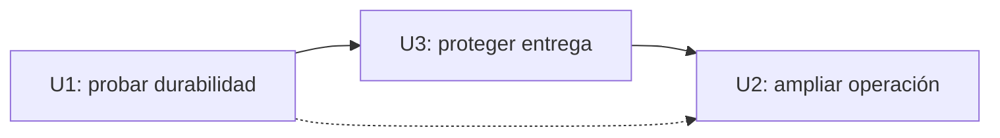

# Riesgos y justificación de la secuencia

Un **Bolt** es una entrega de construcción que acaba en un resultado ejecutable y comprobable. El **walking skeleton** es el primero: una rebanada mínima, pero funcional de extremo a extremo. Se elige esa estrategia para U1 y, después, se prioriza la reducción de riesgo de entrega con U3 antes de ampliar la operación con U2. No se usa WSJF (un modelo de valor y urgencia divididos por tamaño) porque solo hay tres unidades, U1 ya es obligatoria primero y no existen estimaciones numéricas contrastables. Esta es una decisión cualitativa aprobada, no una puntuación implícita.

## Por qué U1 → U3 → U2

1. **U1 primero:** es el único nodo sin dependencias y debe demostrar API Gateway REST → una Lambda → transacción DynamoDB de evento/Outbox → SQS de alertas, con recuperación periódica en la misma Lambda. La incertidumbre principal elegida es la durabilidad lógica de alertas ante fallos y reintentos. La demostración integrada prueba esa hipótesis antes de ampliar el servicio.
2. **U3 segundo:** tras U1, instala comprobaciones, identidad OIDC, CloudTrail y promoción protegida para que el trabajo operativo posterior llegue a `main` con el recorrido crítico protegido. Esto reduce el riesgo de regresión y despliegue. U3 depende de U1, pero no de U2.
3. **U2 tercero:** amplía validación, operación y medición sobre los contratos estables de U1, con los controles de U3 activos. Su prueba de carga y sus alarmas se contrastan en `staging` cuando el entorno exista. La disponibilidad mensual exige un periodo real de observación.

La alternativa U1→U2→U3 respetaría el grafo, pero retrasaría los controles de CI/OIDC y la auditoría mientras se amplía la misma Lambda. La alternativa de agrupar U2+U3 reduciría revisiones, pero ocultaría cuál entrega introdujo una regresión. El orden serial se conserva porque la configuración de Construcción ya lo establece y el usuario lo confirmó; U2 y U3 son independientes en topología, no se añade una dependencia artificial. Se consideran Bolts de tamaño variable según su unidad, sin prometer duraciones inventadas.

**Lectura textual:** U1 habilita tanto U3 como U2. El plan elige U3 antes que U2 por reducción de riesgo, aunque el grafo permitiría el orden inverso.

## Registro de riesgos

| Riesgo | Probabilidad | Impacto | Señal temprana | Mitigación y Bolt responsable |
|---|---|---|---|---|
| Evento persistido sin salida de alerta, o salida perdida tras fallo SQS | Media | Crítico | Transacción parcial, `PENDING` desaparecido o alerta ausente | U1: transacción condicional, Outbox, `alertId` estable y prueba de fallos/recuperación en la misma Lambda. |
| Reentregas físicas causan efectos dobles en consumidor externo | Media | Alto | Mismo evento produce varias acciones de prueba | U1: consumidor contractual de prueba deduplica por `alertId`; la entrega física exactamente una vez no se promete. |
| CDK, IAM, KMS o EventBridge impiden el despliegue o la recuperación | Media | Alto | Síntesis falla, permisos denegados o pendientes no avanzan | U1: síntesis y prueba integrada; U3: acceso OIDC y auditoría; Infrastructure Design fija permisos y concurrencia. |
| Cuenta AWS, permisos u OIDC no disponibles | Desconocida | Alto | No se puede verificar `staging` | Responsable y plazo por confirmar antes de despliegue real; usar simulación solo para la prueba de construcción y conservar el bloqueo visible. |
| Cambio de U2 rompe C1–C5 o la primera prueba integrada | Media | Alto | CI falla o cambia respuesta `202`, `409` o `alertId` | U3 instala la prueba crítica en CI antes de U2; U2 añade pruebas de límites y compatibilidad. |
| p95 > 500 ms a 100 solicitudes válidas/s | Media | Alto | Prueba de carga en `staging` supera objetivo | U2 mide el perfil; Infrastructure Design ajusta capacidad, concurrencia y tiempos sin debilitar NFR1. |
| Se declara disponibilidad mensual sin un mes observado | Alta antes de operar | Medio | Solo hay datos sintéticos | U2 valida fórmula; Operación recoge un mes calendario real antes de afirmar NFR3. |
| Ejemplo de integración usa campos anteriores al contrato | Detectada | Medio | Documentación muestra `type`/`occurredAt` | Se corrigió `refined-mockups/mockups.md` para usar `eventType`/`timestamp`; CI y ejemplos futuros siguen C1. |

## Condiciones de decisión

- No se inicia U3 ni U2 antes de la prueba integrada y aprobación de U1. Una revisión de diseño aislada no demuestra el primer resultado funcional.
- La falta de acceso AWS no invalida la prueba simulada, pero bloquea afirmar que `staging` o CloudTrail reales funcionan. La entrega y el despliegue se reportan por separado.
- Si la prueba de U1 revela pérdida lógica o una nueva Lambda/cola de ingreso, se corrige U1 antes de continuar; no se desplaza esa deuda a U2.
- Si U3 no puede instalar controles por permisos externos, se deja la dependencia visible y no se presenta como CI o despliegue verificados.

## Sources

- `inception/units-generation/unit-of-work.md` y `unit-of-work-dependency.md`
- `inception/contract-design/contract-summary.md`
- `inception/requirements-analysis/requirements.md` (NFR1–NFR10, C1–C7)
- `inception/delivery-planning/delivery-planning-questions.md`
