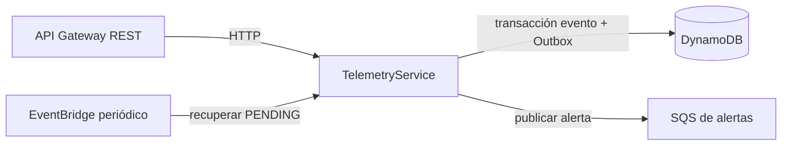

# Catálogo de componentes del dominio

## Catálogo legible por máquina

```yaml
components:
  - name: TelemetryService
    summary: Recibe, valida y persiste telemetría, y mantiene la entrega durable de alertas.
    behaviour: >
      Maneja solicitudes HTTP y activaciones periódicas dentro de un único
      límite lógico. Valida sincronamente antes de persistir. Escribe el evento
      y, cuando corresponde, su salida Outbox en una transacción DynamoDB.
      Publica alertas de batería baja en SQS y recupera salidas PENDING mediante
      la invocación programada de la misma Lambda. La validación, persistencia,
      publicación y recuperación no se separan en Lambdas distintas.
    responsibilities:
      - Validar de forma síncrona los eventos HTTP y rechazar los inválidos sin efectos.
      - Aplicar idempotencia por eventId y preservar el primer evento ante conflicto.
      - Persistir TelemetryEvent y OutboxEntry atómicamente cuando aplique.
      - Crear alertas para batería estrictamente menor que 20, con alertId estable.
      - Reclamar y recuperar salidas PENDING mediante la entrada periódica.
      - Marcar PUBLISHED condicionalmente después de la confirmación de SQS.
      - Emitir resultados y señales operativas correlacionables sin exponer secretos.
    depends_on: []
    dependents: []
    external_dependencies:
      - name: DynamoDB telemetry events table
        kind: database
        purpose: Almacenar eventos persistidos y atributos de aceptación y retención.
      - name: DynamoDB telemetry outbox table
        kind: database
        purpose: Almacenar salidas durables PENDING/PUBLISHED y datos de recuperación.
      - name: SQS alert queue
        kind: queue
        purpose: Recibir únicamente alertas de batería para el consumidor externo.
      - name: API Gateway REST
        kind: other
        purpose: Activar la entrada HTTP de TelemetryService y aplicar la clave de API.
      - name: EventBridge scheduled rule
        kind: other
        purpose: Activar periódicamente la misma Lambda para recuperar salidas PENDING.
    entities:
      - name: TelemetryEvent
        identifier: eventId
        attributes: [eventId, vehicleId, eventType, timestamp, value, acceptedAt, correlationId, expiresAt]
      - name: OutboxEntry
        identifier: alertId
        attributes: [alertId, eventId, alertType, batteryValue, occurredAt, status, nextAttemptAt, attempts, createdAt, lastAttemptAt]
        references:
          - entity: TelemetryEvent
            owned_by: TelemetryService
            relationship: Cada salida de alerta pertenece a un único evento de telemetría.
```

## Diagrama de componentes



## Resumen de componentes

| Component | Purpose | Depends On | Dependents | Entities Owned |
|---|---|---|---|---|
| TelemetryService | Ingesta síncrona, escritura transaccional, Outbox y publicación/recuperación de alertas | DynamoDB de eventos y Outbox; SQS de alertas | Ninguno dentro del dominio | TelemetryEvent, OutboxEntry |

## Propiedad de entidades

| Entity | Owning Component | Identifier | Attributes | References |
|---|---|---|---|---|
| TelemetryEvent | TelemetryService | eventId | eventId, vehicleId, eventType, timestamp, value, acceptedAt, correlationId, expiresAt | — |
| OutboxEntry | TelemetryService | alertId | alertId, eventId, alertType, batteryValue, occurredAt, status, nextAttemptAt, attempts, createdAt, lastAttemptAt | TelemetryEvent, propiedad TelemetryService |

## Dependencias externas

| Component | Dependency | Kind | Purpose |
|---|---|---|---|
| TelemetryService | DynamoDB telemetry events table | database | Persistencia de eventos aceptados y retención. |
| TelemetryService | DynamoDB telemetry outbox table | database | Salida durable y recuperación periódica de pendientes. |
| TelemetryService | SQS alert queue | queue | Publicación de alertas de batería; no es una cola de ingreso. |
| TelemetryService | API Gateway REST | other | Punto de entrada síncrono protegido por clave de API. |
| TelemetryService | EventBridge scheduled rule | other | Activación programada de la misma Lambda para recuperación. |

## Justificación de límites

| Boundary | Rationale |
|---|---|
| TelemetryService como único componente lógico | Las cuatro respuestas de diseño confirmaron un propietario único para validación, persistencia, Outbox y entrega. Así se mantienen juntos los invariantes de idempotencia y escritura atómica y se evita añadir límites que no exige el Walking Skeleton. |
| TelemetryEvent y OutboxEntry bajo TelemetryService | La salida refiere al evento que la origina y se crea en la misma transacción; un único propietario mantiene la relación coherente. |
| Alternativa rechazada: TelemetryIngestion y AlertDelivery | Separar responsabilidades dentro de una Lambda sería posible, pero introduce coordinación y fronteras de propiedad sin ciclos de cambio independientes demostrados. La estructura interna puede modularizarse si esa necesidad aparece. |

## Interacciones y seguridad

- `POST /telemetry-events` activa TelemetryService. La validación de cuerpo y límites de negocio ocurre antes de cualquier escritura; el `202` se devuelve solo después de confirmar la transacción DynamoDB.
- La transacción crea `TelemetryEvent` y, para `battery.value < 20`, `OutboxEntry` con `PENDING` y `alertId` determinista. El valor `20` no crea alerta.
- La regla EventBridge invoca la misma Lambda con una entrada de recuperación. TelemetryService consulta y reclama de forma condicional salidas vencidas, publica a SQS y cambia a `PUBLISHED` solo tras confirmación.
- Fallos o resultados inciertos mantienen la identidad `alertId`; una salida no confirmada continúa recuperable. La SQS de alertas es la única cola del flujo.
- El rol de ejecución requiere acceso mínimo a las tablas y a la cola de alertas. Las credenciales de productor no se guardan en las entidades ni en los logs.

## Racional

El límite es intencionalmente único para el primer esqueleto desplegable, según las respuestas Q1–Q4 y la práctica de evitar SQS de ingreso y Lambdas separadas. API Gateway y EventBridge representan disparadores externos de dos casos de uso del mismo componente; DynamoDB y SQS son dependencias de persistencia y publicación. La alternativa de dividir el componente lógico se conserva como opción futura si los requisitos muestran propietarios, ciclos de cambio o despliegues realmente independientes.
