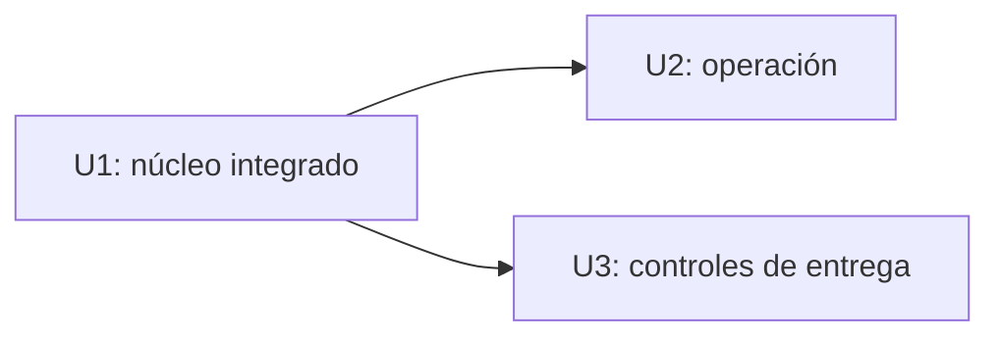

# Dependencias entre unidades de trabajo

## Grafo de dependencias

Las aristas significan «la unidad indicada depende de la unidad nombrada». U1 no depende de otra unidad; U2 y U3 requieren el servicio integrado de U1, pero no se requieren entre sí.

```yaml
units:
  - name: u1-telemetry-core
    kind: service
    depends_on: []
  - name: u2-telemetry-operations
    kind: service
    depends_on: [u1-telemetry-core]
  - name: u3-delivery-controls
    kind: packaging
    depends_on: [u1-telemetry-core]
```



**Lectura textual:** U1 habilita U2 y U3; U2 y U3 son independientes entre sí. El grafo es acíclico. La elección económica de qué trabajo entregar primero corresponde a Delivery Planning.

## Primera rebanada integrada

U1 es el primer nodo elegible del grafo y puede ejecutarse sin U2 ni U3. Su demostración recorre API Gateway REST → única Lambda → transacción DynamoDB de evento y salida Outbox → SQS de alertas; EventBridge invoca la misma Lambda para reclamar y recuperar salidas `PENDING`. Incluye el caso inválido sin efectos, la condición estricta `value < 20`, el `202` posterior a la transacción y la salida recuperable tras un fallo de publicación. La prueba crítica con servicios AWS simulados comprueba ambas entradas de la Lambda.

## Puntos de integración

| Relación | Contrato compartido | Mecanismo y responsabilidad |
|---|---|---|
| U1 → U2 | `POST /telemetry-events`, `TelemetryEvent`, `OutboxEntry`, estados `PENDING`/`PUBLISHED` y `alertId` | U2 modifica el mismo servicio y usa los registros de U1. Mantiene compatibilidad de campos e idempotencia. |
| U1 → U3 | CDK base, artefacto Lambda y prueba crítica | U3 configura CI, identidad temporal OIDC y auditoría/despliegue para el mismo artefacto; la aprobación de producción queda separada. |
| U1 → consumidor externo | Mensaje SQS de alertas con `alertId` estable | U1 publica; el consumidor contractual de prueba verifica deduplicación lógica. El consumidor real queda fuera de alcance. |

## Desarrollo paralelo permitido

U2 y U3 no tienen arista entre sí y admiten trabajo paralelo tras establecer los contratos de U1. La preparación de pipeline de U3 puede comenzar antes, pero no se considera completada hasta ejecutar las pruebas sobre U1. Ninguna unidad introduce una cola de ingreso, otra Lambda o un propietario de `TelemetryEvent`/`OutboxEntry`.

## Sources

- `inception/domain-design/components.md`
- `inception/domain-design/decisions.md`
- `inception/units-generation/units-generation-questions.md`
